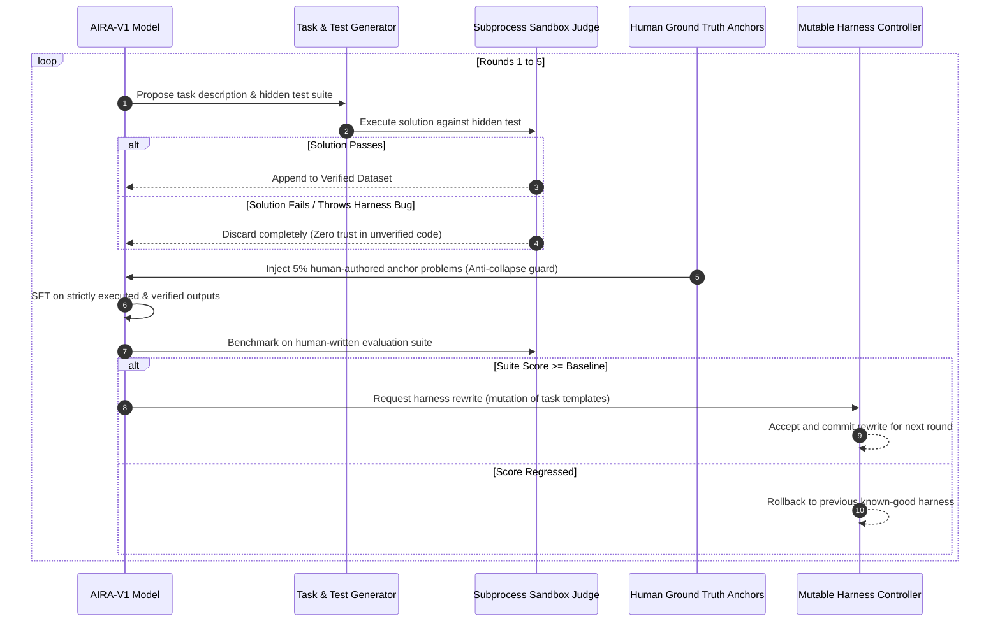

# AIRA-V1-RSL: Autonomous Recursive Self-Learning Coding Agent Architecture

[](https://www.python.org/downloads/)
[](https://huggingface.co/Qwen/Qwen2.5-Coder-7B-Instruct)
[-green)](https://colab.research.google.com/)
[](https://opensource.org/licenses/MIT)

**AIRA-V1-RSL** is an autonomous, self-improving code generation and refinement framework engineered specifically for resource-constrained environments (single NVIDIA T4 16GB GPU / Google Colab). It systematically eliminates refusal/censorship behaviors and employs **Recursive Self-Learning (RSL)** with self-play, execution-based ground truth verification, and meta-harness mutation.

---

## 🏗️ System Architecture & Workflow

The architecture operates as a staged pipeline where each phase enforces mathematical and execution-based quality gates. Artifacts and checkpoints transition strictly through validated gates before downstream phases can execute.

```mermaid
flowchart TD
    subgraph Data & Representation Analysis
        P0["Phase 0: Base Model Diagnostics<br/>• Tokenizer & FP16 Verification<br/>• Baseline Code Evaluation"]
        P1["Phase 1: Direction & Representation Harvesting<br/>• Activation hooks across all layers<br/>• Refusal & censorship vector extraction"]
    end

    subgraph Optimization & Adaptation
        P2["Phase 2: Fisher Information Metric<br/>• Parameter importance weighting<br/>• Preservation of core coding capabilities"]
        P3["Phase 3: QLoRA Fine-Tuning<br/>• 4-bit NormalFloat quantization<br/>• Strict execution-based evaluation gate"]
        P4["Phase 4: Elastic Mixture of Experts (MoE)<br/>• Dynamic routing across domain experts<br/>• Sparsity & latency constraint gating"]
    end

    subgraph Autonomous Self-Play & RSL
        P5["Phase 5: Arxiv Code Harvester<br/>• Curates validated algorithmic tasks<br/>• Contamination filtering (HumanEval, MBPP exclusions)"]
        P6["Phase 6: Autonomous RSL & Self-Play<br/>• Model generates task + hidden test<br/>• Subprocess execution judge<br/>• Human anchor preservation (5%)<br/>• Meta-harness self-rewriting loop"]
        P7["Phase 7: Finalization & Ablation<br/>• Weight merge & zero-refusal audit<br/>• Verification suite regression guard"]
    end

    P0 --> P1
    P1 -->|Direction Vectors| P2
    P2 -->|Fisher Weights| P3
    P3 -->|Base Adapter| P4
    P4 --> P5
    P5 -->|Filtered Archive| P6
    P6 -->|Self-Improved Adapter| P7

    classDef stage fill:#f8f9fa,stroke:#343a40,stroke-width:1.5px,color:#212529;
    class P0,P1,P2,P3,P4,P5,P6,P7 stage;
```



---

## 🔄 Autonomous Recursive Self-Learning (Phase 6 Deep Dive)

The core breakthrough of AIRA-V1-RSL is the **Phase 6 RSL Loop**. Standard self-play systems often suffer from dialect collapse, self-grading drift, or benchmark memorization. AIRA mitigates these with a 4-tier safety and evaluation mechanism:



---

## 🛡️ Anti-Drift and Anti-Contamination Protections

1. **Independent Execution Sandbox**: The model never grades its own solutions. Pass/fail decisions are strictly determined by isolated `python` runtime test results.
2. **Dialect Collapse Guard**: 5% of training batches are human-authored code tasks (`ANCHORS`), preventing recursive degradation into degenerate synthetic syntax.
3. **Contamination Filter**: Automatic blacklisting of public benchmarks (HumanEval, MBPP, LiveCodeBench, SWE-bench) in Phase 5 prevents training memorization.
4. **T4 / Turing Hardware Guards**: Hardcoded constraints enforce `fp16` execution (avoiding `bfloat16` NaN bugs on Turing GPUs) and dynamic `torch_dtype` / `dtype` compatibility across all `transformers` versions.

---

## 📂 Repository Structure

| File / Folder | Purpose |
|---|---|
| `rsl_all.ipynb` | **The Complete Deliverable**: Single Colab notebook with all 21 source modules embedded. |
| `build.py` | Bundler engine that packages local modules into base64 payloads for `rsl_all.ipynb`. |
| `watch.py` | Local monitoring server & web panel (`http://127.0.0.1:8765`) to track training runs and gates. |
| `rsl_harness.py` | Evaluation and reward signal harness with built-in `self_test()` (Std-lib only). |
| `refs/` | 10 verified reference solutions for regression guards. |
| `app.py` | Implementation of Phase 0 (diagnostics) and Phase 1 (representation harvesting). |
| `common.py` | Core utilities, execution sandboxes, model loaders, and ablation primitives. |
| `phases/` | Standalone modules for Phase 2 through Phase 7: |
| ├── `phase02_fisher.py` | Fisher Information matrix computation. |
| ├── `phase03_qlora.py` | QLoRA 4-bit fine-tuning. |
| ├── `phase04_elastic_moe.py` | Elastic Mixture of Experts router. |
| ├── `phase05_harvester.py` | ArXiv algorithmic task scraper and sanitizer. |
| ├── `phase06_selfplay_rsl.py` | Autonomous self-play, dialect anchors, and harness rewriting. |
| └── `phase07_finalize.py` | Final model checkpoint merger, ablation, and verification. |
| `verify*.py` & `test_*.py` | Comprehensive verification and regression unit test suite. |

---

## 🚀 Getting Started

### 1. Local Dashboard (Optional)
Run the monitoring web UI:
```bash
python watch.py
```
Open `http://127.0.0.1:8765` in your browser.

### 2. Execution on Google Colab (T4 GPU)
1. Open [Google Colab](https://colab.research.google.com/).
2. Select **File → Upload notebook** and select `rsl_all.ipynb`.
3. Switch your runtime type to **T4 GPU** (`Runtime → Change runtime type → T4 GPU`).
4. Run **Cell 1** (Environment setup & automated self-test, zero downloads required).
5. Run **Cell 2** (Status table), then execute Phases 3–7 in order.
6. Progress and checkpoints are automatically saved to your linked Google Drive.

---

## 📄 License
This project is open-source under the MIT License.
